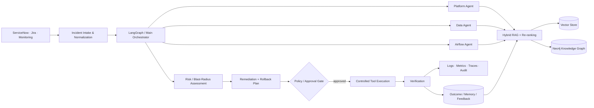
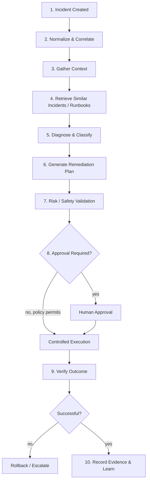

# Enterprise Agentic AI Incident Remediation Platform

> **Flagship Data + AI Architecture Project** — governed multi-agent incident triage, hybrid RAG, knowledge graphs, risk-aware remediation, human approval, controlled execution, rollback, verification, and end-to-end observability.

This repository explores how an enterprise incident workflow can move from **ServiceNow/Jira/monitoring event → context retrieval → AI-assisted diagnosis → remediation planning → policy/risk gates → human approval → controlled execution → verification and learning**.

The project is presented from a **Lead Data & AI Architect** perspective. The emphasis is not simply on calling an LLM: it is on the surrounding architecture required to make agentic workflows observable, governed, stateful, testable, and safe enough to integrate with real operational systems.

> **Portfolio note:** This is an architecture/MVP project. Capabilities described here should not be interpreted as production deployment claims, certified controls, or measured business outcomes unless explicitly identified as measured.

---

## Architecture at a glance



### Core principle

**AI proposes and reasons; policy-controlled deterministic systems validate, authorize and execute.**

Consequential infrastructure or data-platform actions should not be triggered merely because an LLM produced a high-confidence answer.

---

## What the platform demonstrates

| Architecture domain | Capability |
| --- | --- |
| Incident orchestration | Multi-step stateful workflow with specialist-agent collaboration |
| Enterprise RAG | Semantic + lexical/metadata retrieval, re-ranking and historical remediation context |
| Knowledge graph | Neo4j relationships for services, incidents, dependencies and prior outcomes |
| Agent/tool integration | MCP-style tool boundaries and external-system connectors |
| Risk governance | Risk scoring, blast-radius thinking and policy gates |
| Human-in-the-loop | Approval before consequential/high-risk execution |
| Controlled remediation | Auditable automation through constrained execution mechanisms |
| Rollback & verification | Recovery plan plus post-action validation |
| State & memory | Workflow state, operational history and retrieval feedback |
| Observability | Agent/tool traces, logs, metrics, execution evidence and audit history |

---

## Enterprise incident lifecycle



The design goal is full lifecycle traceability: **what happened, what evidence was retrieved, what the agents proposed, why an action was approved, what executed, and whether it actually fixed the incident**.

---

## RAG & knowledge architecture

The project explores a multi-stage retrieval pipeline rather than relying only on vector similarity:

1. Normalize incident text and operational metadata.
2. Retrieve candidate runbooks, scripts and historical incidents.
3. Combine semantic, lexical and metadata signals.
4. Re-rank the candidate set for the specific incident context.
5. Enrich results with graph relationships and dependency context.
6. Pass evidence — not an unconstrained knowledge dump — to the reasoning workflow.
7. Record execution/verification outcomes for future evaluation.

### Retrieval technologies represented

`Weaviate / Vector Search` · `Neo4j` · `SentenceTransformers` · `Hybrid Retrieval` · `Cross-Encoder Re-ranking` · `Metadata Filtering` · `Feedback / Evaluation`

Retrieval weights and thresholds are implementation/configuration choices and should be tuned against an evaluation dataset rather than treated as universal constants.

---

## State and memory model

A production agent platform needs more than chat history.

| State type | Examples |
| --- | --- |
| Workflow state | current phase, pending actions, approval state, retries |
| Incident context | source event, affected service, environment, severity |
| Retrieved evidence | runbooks, similar incidents, scripts, graph relationships |
| Decision evidence | model/tool versions, risk result, approval reason |
| Execution evidence | action, parameters, timestamps, result, rollback state |
| Long-term knowledge | verified remediation outcomes and reusable operational context |

State should have explicit ownership, persistence, retention, authorization and versioning rules.

---

## Governance and production safety

For production environments, the architecture should enforce controls outside the LLM boundary:

- Least-privilege service identities
- Typed and allow-listed tools
- Environment-aware authorization
- Human approval for consequential production actions
- Input/output schema validation
- Script/module allow-listing and provenance
- Secrets isolation
- Idempotency and retry controls
- Rollback or compensating actions
- Post-execution verification
- Immutable audit evidence
- Prompt/model/tool/policy version tracking
- Adversarial and safety evaluation

---

## Observability

Agentic systems need both **software telemetry** and **decision telemetry**.

```text
Incident ID / Trace ID
        │
        ├── Intake & normalization
        ├── Agent / workflow transitions
        ├── Retrieval queries + evidence IDs
        ├── LLM/model invocation metadata
        ├── Tool calls and authorization result
        ├── Human approval decision
        ├── Execution / rollback
        └── Verification + final outcome
```

Useful evaluation dimensions include retrieval quality, classification accuracy, remediation relevance, tool-call correctness, approval/escalation rate, execution success, reopened incidents, latency, cost and safety-policy violations.

---

## Technology stack

### AI & orchestration

**Python · LangGraph · LangChain patterns · LLM APIs · SentenceTransformers · RAG · Re-ranking · MCP-style tools**

### Data & state

**PostgreSQL · Redis · Weaviate · Neo4j · Apache Kafka**

### API & UI

**FastAPI · Next.js · TypeScript**

### Platform & execution

**Docker · Kubernetes · GitHub Actions · GCP integration patterns · CI/CD**

### Operations

**Observability · Audit Trails · Health Checks · Evaluation · Human-in-the-Loop · Rollback**

---

## Repository map

```text
test_01/
├── backend/                  # orchestration, RAG, streaming and service logic
├── frontend/                 # operator / workflow UI
├── mcp-servers/              # tool integration layer
├── deployment/               # runtime/infrastructure configuration
├── monitoring/               # observability assets
├── data/                     # project/evaluation data
├── docs/                     # architecture and detailed documentation
├── scripts/                  # controlled automation / project scripts
├── .github/                  # CI/CD and execution workflows
├── CODE_DOCUMENTATION.md     # detailed implementation documentation
├── INCIDENT_LIFECYCLE_AND_RAG.txt
├── registry.json             # project/tool registry metadata
├── start-all.sh
├── stop-all.sh
└── README.md
```

The repository name `test_01` is historical. The project itself is treated as a serious architecture portfolio asset; a future repository rename can improve discoverability without changing the underlying design.

---

## Production evaluation roadmap

Before considering autonomous remediation mature, I would evaluate:

- Incident classification precision/recall
- Retrieval Recall@K / Precision@K / MRR or task-specific relevance metrics
- Re-ranking lift against a labelled incident/runbook set
- Remediation-plan correctness
- Unsafe or unauthorized tool-call rate
- Human override/rejection rate
- Execution success and rollback success
- Reopened incident rate
- End-to-end resolution latency
- Cost per resolved workflow
- Trace completeness and auditability
- Adversarial/prompt-injection resistance

Targets should be clearly separated from measured results.

---

## Portfolio relevance

This project demonstrates architecture skills aligned with:

**Lead Data & AI Architect · AI Architect · GenAI Architect · Agentic AI Architect · Data Platform Architect · Principal Data Engineer · Cloud AI Architect**

It connects **enterprise operations + data platforms + RAG + knowledge graphs + AI agents + governance + observability** into one end-to-end system rather than treating each technology as an isolated demo.

---

### Search keywords

`Agentic AI` · `AI Agents` · `Multi-Agent Systems` · `Generative AI` · `RAG` · `Hybrid RAG` · `LangGraph` · `LangChain` · `MCP` · `Neo4j` · `Weaviate` · `Vector Database` · `Knowledge Graph` · `FastAPI` · `Kafka` · `Kubernetes` · `GCP` · `ServiceNow` · `Jira` · `Incident Management` · `AIOps` · `LLMOps` · `AI Governance` · `AI Observability` · `Human-in-the-Loop` · `Enterprise AI Architecture`

---

*Architecture portfolio project by Samrat Tidke — Lead Data & AI Architect.*